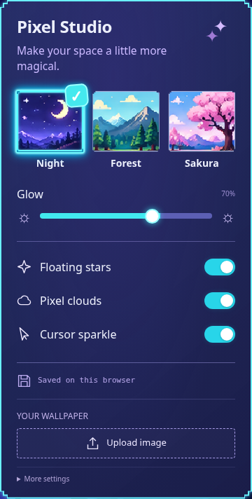
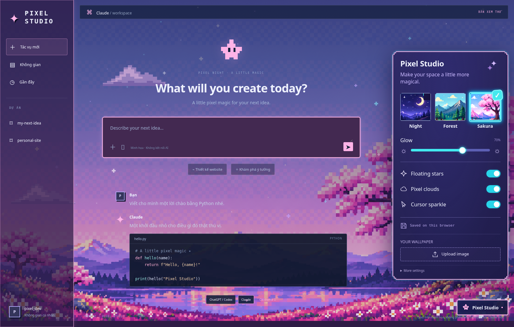

# themeAI — Pixel Studio ✦

Theme pixel cho **ChatGPT, Codex web và Claude**: trời đêm, trăng khuyết, núi và cây, mây trôi, sao lấp lánh và tia sáng theo chuột. Ba cảnh **Night**, **Forest**, **Sakura**, chỉnh trực tiếp trên trang.



[Xem ảnh toàn trang Night trên giao diện minh họa ChatGPT/Codex](docs/pixel-night-chatgpt.png)

> Ảnh chụp trang minh họa đi kèm, không phải ảnh tài khoản ChatGPT/Claude thật. Theme trang trí giao diện gốc; không thay nội dung, bố cục điều hướng hay thương hiệu của các ứng dụng bằng giao diện demo.

## Bản 1.1.0

- Bảng chọn cảnh dùng chính ba hình trong mẫu đã duyệt, với viền cyan, dấu tick, nền indigo và công tắc tròn như ảnh tham chiếu.
- Ba nền mới là tranh pixel với cạnh bậc thang và màu khối rõ ràng; Forest là cảnh ban ngày và Sakura có cây anh đào hồng.
- Có **Upload image**: chọn ảnh từ máy tính, dùng **Fill screen** để phủ kín hoặc **Fit image** để thấy trọn ảnh. **Use image** chọn lại ảnh đã lưu; **Remove** xóa ảnh đó và trở về Night.
- Ảnh riêng chỉ lưu trên trình duyệt; không gửi lên GitHub hay máy chủ. Trình duyệt thu gọn ảnh về tối đa 2048px cạnh dài để tiết kiệm kho lưu trữ. Hỗ trợ ảnh mà trình duyệt đọc được, gồm JPG, PNG, WebP, GIF, SVG và AVIF; GIF dùng khung hình tĩnh. File đầu vào tối đa 32 MB.

**Cập nhật từ bản 1.0.0:** thay toàn bộ thư mục `extension` cũ bằng thư mục trong bộ cài mới, bấm **Reload** tại trang tiện ích, rồi tải lại ChatGPT/Claude. Với Tampermonkey, cài đè bản 1.1.0 để trình quản lý tải đủ các tài nguyên ảnh mới.

## Cài đặt

Chọn **một** trong hai cách. Nếu đã cài bộ Neon Studio cũ, tắt bản cũ để hai bộ màu không chồng lên nhau.

### Chrome / Edge — tiện ích

1. **[Tải bộ cài ZIP](https://github.com/hpb282/themeAI/raw/refs/heads/main/downloads/themeai-pixel-studio.zip)** và giải nén. Nếu muốn lấy toàn bộ mã nguồn, dùng **Code → Download ZIP**. Bộ cài đã được build sẵn; không cần Node.js hay chạy lệnh.
2. Nhập `chrome://extensions` hoặc `edge://extensions` vào thanh địa chỉ.
3. Bật **Developer mode / Chế độ dành cho nhà phát triển**.
4. Chọn **Load unpacked / Tải tiện ích đã giải nén**.
5. Chọn đúng thư mục **`extension`** bên trong thư mục vừa giải nén, nơi có `manifest.json`.
6. Tải lại tab ChatGPT/Codex hoặc Claude. Bấm **✦ Pixel Studio** ở góc dưới phải.

Giữ thư mục `extension` trên máy sau khi cài. Khi cập nhật, thay bộ file rồi bấm **Reload** ở trang quản lý tiện ích, sau đó tải lại các tab AI.

### Tampermonkey — userscript

1. Cài Tampermonkey từ cửa hàng chính thức của trình duyệt. Firefox cũng có thể dùng cách này.
2. **[Mở file themeai.user.js để cài](https://raw.githubusercontent.com/hpb282/themeAI/main/themeai.user.js)**. Nếu Tampermonkey hiện màn hình cài, chọn **Install**.
3. Nếu trình duyệt chỉ hiện mã: Tampermonkey → **Create a new script**, thay toàn bộ nội dung bằng mã trong file trên và **Ctrl+S**.
4. Bật **Allow User Scripts** trong phần chi tiết Tampermonkey nếu Chrome yêu cầu. Phiên bản Chrome cũ có thể yêu cầu bật Developer mode.
5. Tải lại ChatGPT/Codex và Claude.

## Sử dụng

| Tùy chọn | Chức năng |
| --- | --- |
| **Night** | Trời đêm indigo, trăng vàng và neon cyan |
| **Forest** | Hồ núi ban ngày, trời xanh cyan và rừng thông xanh |
| **Sakura** | Chiều tím hồng, cây hoa anh đào pixel |
| **Glow** | Chỉnh sao, mây, núi và quầng sáng viền từ 10–100% |
| **More settings → Chuyển động** | Bật/tắt chuyển động của cảnh và tia sáng |
| **Floating stars / Pixel clouds / Cursor sparkle** | Bật/tắt riêng từng hiệu ứng |
| **Chuyển góc** | Đưa nút/bảng cài đặt sang góc trái hoặc phải trong tab hiện tại |
| **More settings → Bật theme pixel** | Tắt để trả lại màu gốc; nút cài đặt vẫn còn |
| **Khôi phục mặc định** | Night, độ sáng 70%, bật các hiệu ứng |

- Lựa chọn theme được lưu chung và đồng bộ giữa ChatGPT và Claude bằng `chrome.storage.local` hoặc kho của Tampermonkey, trên cùng trình duyệt và cùng bản cài.
- Vị trí góc trái/phải là tùy chọn tạm của mỗi tab, không đồng bộ.
- Nếu hệ thống bật **Reduce motion / Giảm chuyển động**, theme giữ cảnh đứng yên và tắt tia sáng theo chuột, kể cả khi công tắc chuyển động đang bật.
- Chuyển động dừng khi tab bị ẩn. Tia sáng chỉ hoạt động với con trỏ chuột, không áp dụng khi chạm màn hình.
- Bấm **×** hoặc **Escape** khi đang ở bảng cài đặt để đóng. Bấm ra ngoài cũng đóng bảng.
- Nên chọn giao diện tối trong ứng dụng AI để các thành phần có màu riêng đồng nhất với theme.



## Phạm vi hỗ trợ

| Ứng dụng web | Địa chỉ |
| --- | --- |
| ChatGPT | `https://chatgpt.com/*` và địa chỉ cũ `https://chat.openai.com/*` |
| Codex web | `https://chatgpt.com/codex`, `https://codex.chatgpt.com/*`, `https://codex.com/*` |
| Claude | `https://claude.ai/*` |

Tiện ích Chrome/Edge dành cho trình duyệt máy tính. Không áp dụng cho ứng dụng desktop, ứng dụng điện thoại hoặc Codex CLI. Không chạy trong iframe hoặc trang ngoài danh sách trên. Cấu trúc và màu của một số bảng riêng, trình xem tài liệu hay artifact có thể được ứng dụng giữ lại. Các website có thể thay đổi DOM hoặc token CSS, khi đó adapter cần cập nhật.

## Dữ liệu và quyền

- Không thư viện/CDN, phông chữ hoặc mã tải từ bên ngoài trong lúc theme chạy. Bản tiện ích đọc ảnh từ các file WebP trong chính thư mục cài đặt. Bản Tampermonkey tải bốn ảnh từ repo này khi cài/cập nhật bằng `@resource`, rồi đọc bản đã được trình quản lý lưu; không tải lại ảnh nền từ máy chủ khi dùng theme.
- Không có yêu cầu mạng, phân tích truy cập, đọc cookie, token, nội dung hội thoại hay phím gõ toàn trang. Theme chỉ tìm cấu trúc ô nhập/sidebar để thêm dấu đánh dấu CSS.
- Quyền tiện ích duy nhất được khai báo trong `permissions` là **`storage`** để lưu lựa chọn. Các `content_scripts.matches` giới hạn trang được trang trí; trình duyệt vẫn hiển thị quyền truy cập các website đó.
- Bản userscript yêu cầu quyền lưu/đọc, đồng bộ cài đặt và đọc các ảnh `@resource` đã lưu của Tampermonkey. Ảnh riêng dùng kho cục bộ riêng, không phải file trong repo.
- Nội dung chat, trình xử lý gửi, font hội thoại và tô màu cú pháp được giữ nguyên. Không thay thế DOM của ứng dụng.
- Mã nguồn không dùng `eval`, `innerHTML` hoặc sửa chính sách Trusted Types của website.

## Gỡ hoặc hoàn tác

- **Tạm tắt:** Pixel Studio → tắt **Bật theme pixel**.
- **Gỡ tiện ích:** `chrome://extensions` / `edge://extensions` → **Remove**.
- **Gỡ userscript:** Tampermonkey Dashboard → tắt hoặc xóa **ThemeAI — Pixel Studio**.
- Tải lại các tab sau khi gỡ để xóa nút và các style đã chèn. Xóa tiện ích cũng xóa kho cài đặt của tiện ích; Tampermonkey quản lý kho riêng của userscript.

## Xem thử và phát triển

Các file cài đặt nằm sẵn trong repo. Chỉ cần các lệnh sau khi muốn sửa mã nguồn:

```sh
# Build, không cần dependency ngoài Node.js 20+
npm run build
npm run check

# Xem demo tại http://localhost:8765/docs/
python3 -m http.server 8765

# Đóng gói extension + userscript + hướng dẫn, dùng Python 3
python3 scripts/package.py

# Kiểm thử trình duyệt
npm install
npx playwright install chromium
npm test
```

`src/` là mã nguồn. `extension/theme.js` và `themeai.user.js` được sinh từ cùng một runtime, tránh hai bản lệch tính năng. `src/landscapes.mjs` khai báo màu, các lớp vector nhỏ và tọa độ lấy hình từ mẫu đã duyệt; bốn ảnh WebP thực nằm trong `extension/assets/`. Các WebP được chuyển mã lossless từ ảnh nguồn. File ZIP cài sẵn nằm trong `downloads/`. Build không phụ thuộc dịch vụ bên ngoài. File icon PNG được sinh bằng `scripts/package.py` và đã được commit sẵn.

### Kiểm chứng

Đã kiểm thử runtime trong Chromium trên các trang DOM mô phỏng ChatGPT và Claude: thay palette, lưu cài đặt, adapter đồng bộ giữa hai origin, giảm chuyển động, tắt/khôi phục nền gốc, giữ nguyên input/code, form/menu gốc, điều hướng SPA, tránh chèn trùng, bảng cài đặt ở viewport 390px, trường hợp kho lưu bị chặn/hỏng, cùng luồng tải ảnh từ máy, lưu ảnh sau reload, đổi cách lấp nền, xử lý file hỏng, chọn lại và xóa ảnh riêng. Demo đã được kiểm tra trực quan ở desktop và màn hình hẹp.

Đã đối chiếu token màu với CSS công khai của cả hai dịch vụ và kiểm tra nạp theme trên trang chưa đăng nhập. Trang ChatGPT công khai nhận diện được ô nhập/sidebar; trang Claude chưa đăng nhập không cung cấp đầy đủ trình soạn chat để kiểm tra. Đây không phải kiểm chứng trên tài khoản đã đăng nhập của hai dịch vụ. Việc tự nạp extension từ manifest chưa được thử trong môi trường kiểm tra có chính sách chặn cài tiện ích; các bài kiểm tra thực thi trực tiếp file runtime và giả lập API lưu trữ của extension. Không cần tắt chính sách bảo mật của trình duyệt để chạy các bài kiểm tra runtime.

Theme bên thứ ba, không phải sản phẩm chính thức của OpenAI hoặc Anthropic.
